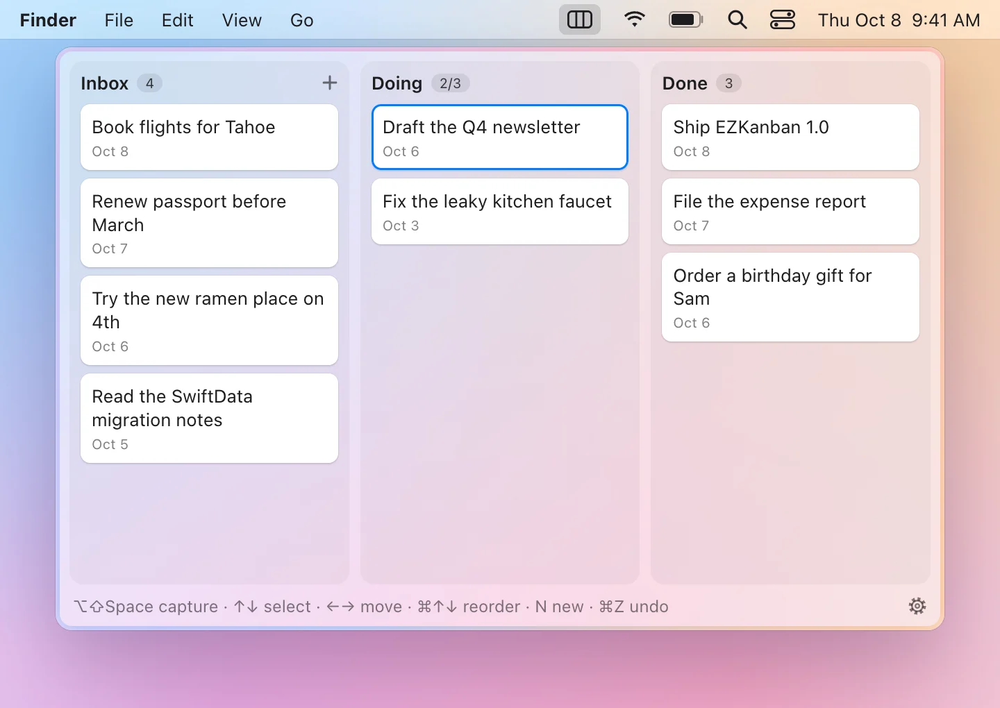

# EZKanban

A tiny menu bar kanban for macOS 14+. Capture a task from anywhere with a hotkey, then sort it later on a three-column board (Inbox → Doing → Done). There are no accounts, no sync, and no analytics.

Download the signed, notarized app from [labs.axiomic.ai/ezkanban](https://labs.axiomic.ai/ezkanban/).



## Build

1. Open `EZKanban.xcodeproj` in Xcode.
2. Press ⌘R. Xcode fetches the one dependency, [KeyboardShortcuts](https://github.com/sindresorhus/KeyboardShortcuts), on the first build.

The project is generated from `project.yml`. If you add or rename files, run `xcodegen generate` (`brew install xcodegen`).

The app only lives in the menu bar (look for the ▥ icon) and has no Dock icon. Press **⌥⇧K** to open or close the board from anywhere. To quit, use the gear menu at the bottom of the board.

## Quick capture

Press **⌥⇧Space** from any app, including full-screen ones. Type the task and press **Return** to add it to the top of Inbox. Press **Esc** to discard it. If you click away instead, the panel hides and keeps your draft. You can change the hotkey in Settings.

If you paste several lines, each line becomes its own card. List markers such as `- `, `• `, `1. ` and `- [ ] ` are stripped, and the bar shows how many cards Return will add.

## Board

| Key | Action |
| --- | --- |
| ↑ / ↓ | Select a card |
| ← / → | Move the selected card to the previous or next column |
| ⌘↑ / ⌘↓ | Reorder the card within its column |
| Return | Edit the card (or click it) |
| ⌫ | Delete the card (or use the hover trash icon) |
| N | New card (or click the + button) |
| ⌘Z / ⇧⌘Z | Undo / redo the last add, edit, move or delete |
| ⌘, | Settings |
| Esc | Close the board |

You can also drag cards between columns and within a column. Doing holds at most 3 cards. Done cards leave the board 48 hours after they were moved there and are appended to `archive.jsonl`. This cleanup runs when the app launches and whenever you open the board.

## Storage

The board is saved in `~/Library/Application Support/EZKanban/board.json`:

```json
{
  "cards" : [
    {
      "column" : "inbox",
      "createdAt" : "2026-10-08T20:33:15Z",
      "id" : "8B24DED2-21F7-4CDC-8327-86AEFD02DB7C",
      "movedAt" : "2026-10-08T20:33:15Z",
      "order" : 0,
      "text" : "Buy milk"
    }
  ]
}
```

- Keys are sorted alphabetically, and every change is written atomically.
- You can edit the file by hand, and the open board updates live. Only `text` is required. A missing `id`, `order` or date is filled in, and `column` is not case-sensitive.
- Expired Done cards are appended to `archive.jsonl` in the same folder, one JSON object per line with an extra `archivedAt` field.
- If a hand edit leaves the file unparseable, the app keeps the board it already has in memory. Before it next saves, it copies your broken file to `board.invalid-<timestamp>.json`, so the edit is never lost.

## Settings

Open Settings from the gear menu on the board or with ⌘,. You can change both hotkeys, launch at login, show the Inbox count in the menu bar, and reveal `board.json` in Finder. Launch at login works best once the app is copied to `/Applications`.

## Releasing

`./scripts/release.sh` archives a universal build, signs it with the Axiomic Developer ID, notarizes and staples it, and writes `build/EZKanban.dmg`. Upload that file to a GitHub release under exactly that name, because the website's download link resolves by filename. Release notes live in `CHANGELOG.md`. The script explains its one-time notarization setup, and it can also package an app that Xcode has already notarized (`--package-only`).

## License

MIT. See [LICENSE](LICENSE). Copyright © 2026 Axiomic, LLC.
